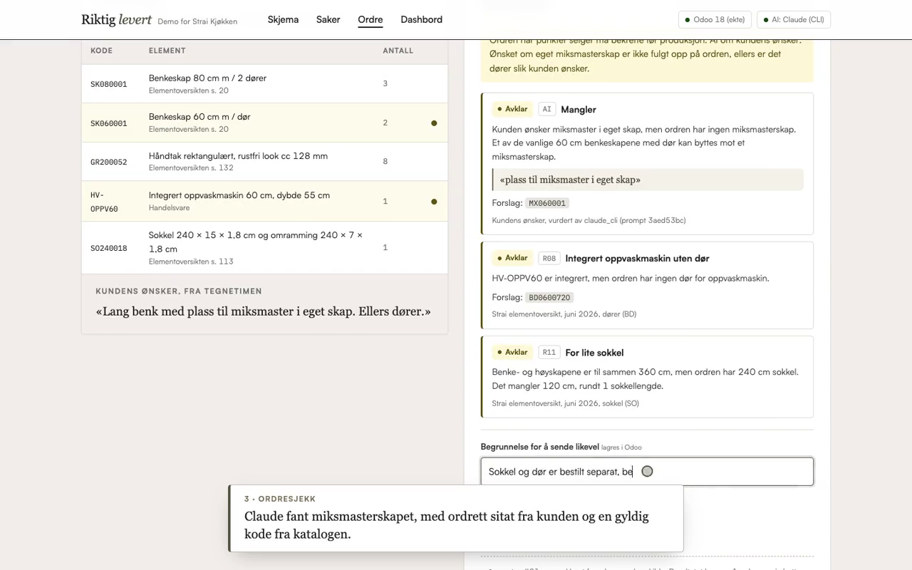
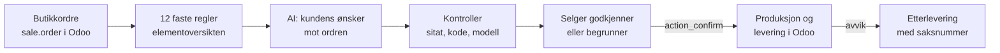
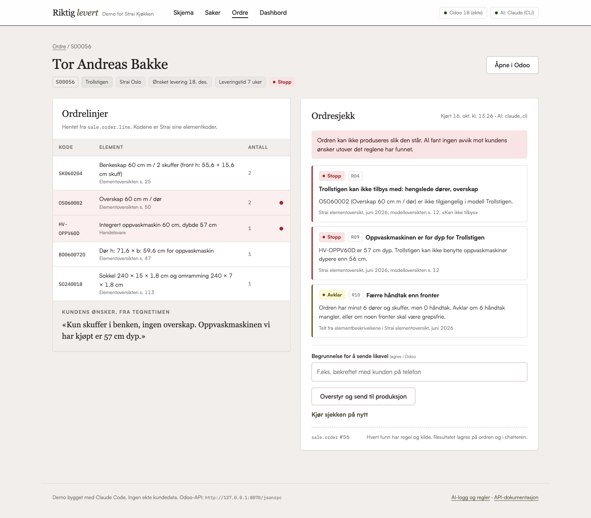
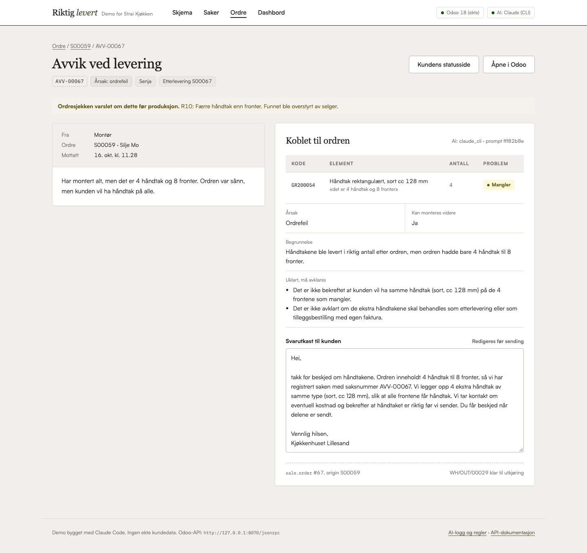
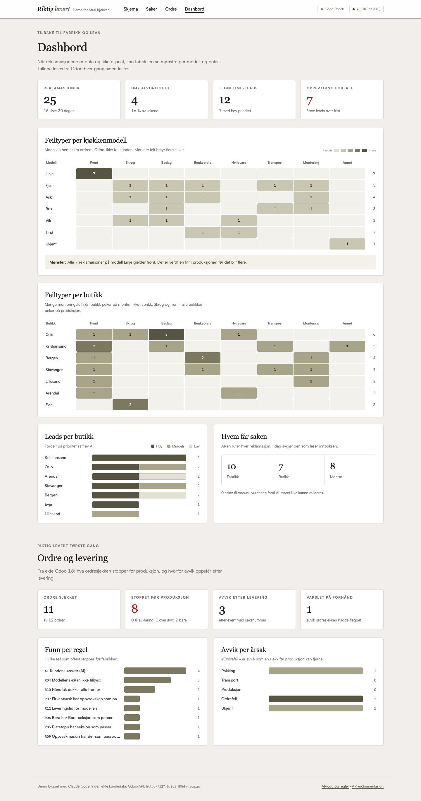
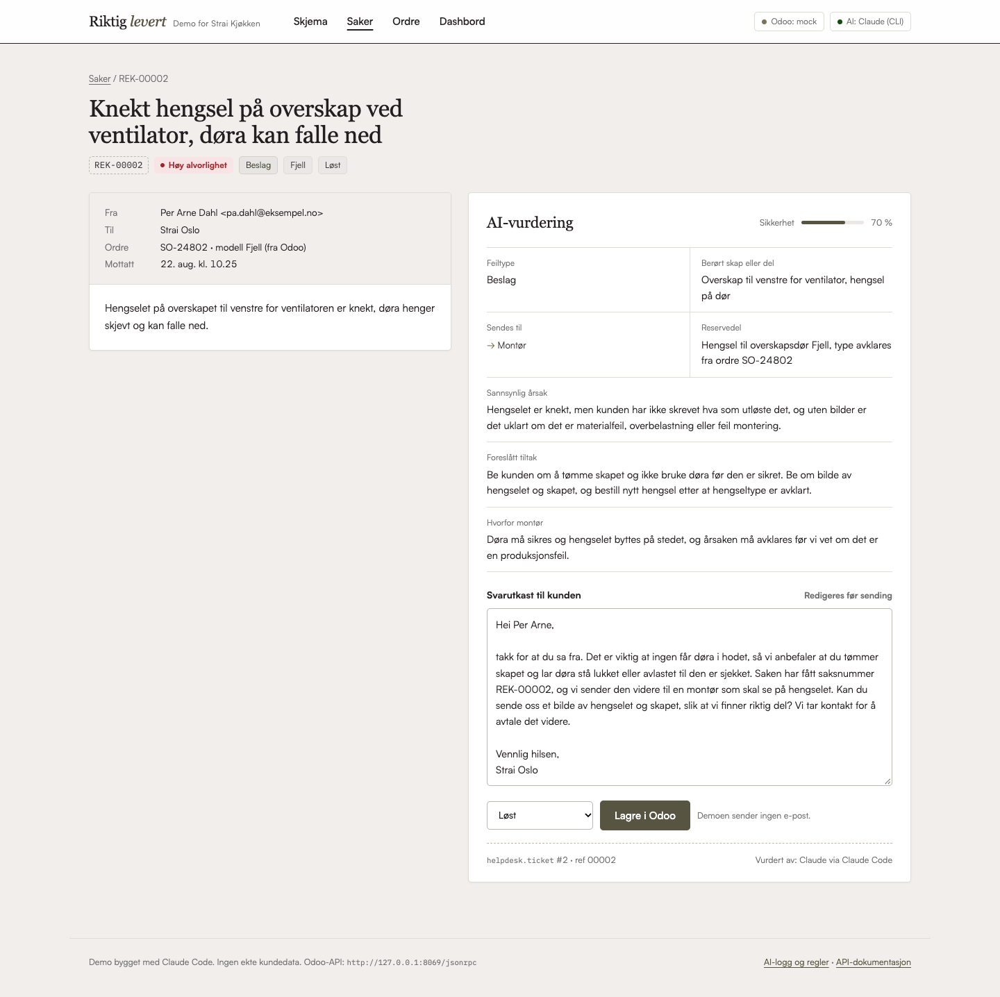
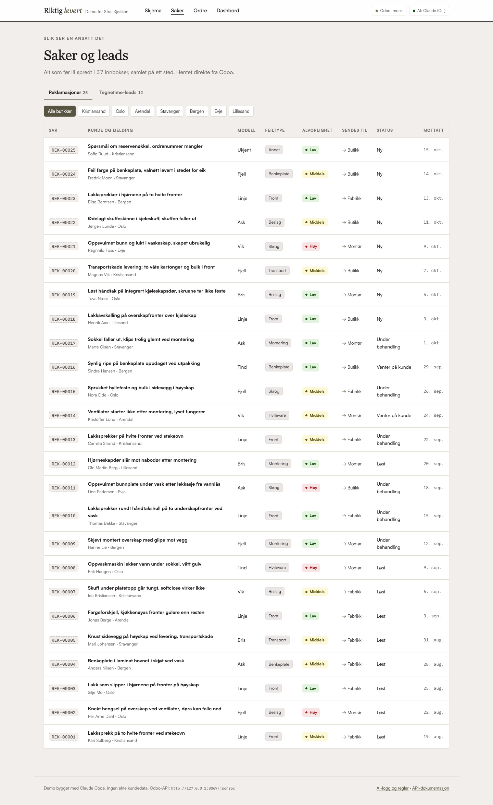

# Riktig levert første gang

To demoer av samme idé for Strai Kjøkken: **AI i midten, Odoo som fasit, et menneske som godkjenner.**

1. **Ordresjekk før produksjon og avvik ved levering** (hoveddelen). En butikkordre i Odoo sjekkes mot Strai sin egen elementoversikt og mot kundens ønsker før den går til fabrikken. Mangler og skader etter levering blir etterleveringsordre i Odoo med saksnummer, ikke e-post.
2. **Fra innboks til Odoo.** Reklamasjons- og tegnetimeskjemaet på strai.no blir strukturerte saker og leads i Odoo, med AI-vurdering.

[](https://github.com/Magicsidd/strai-demo/raw/main/docs/demo.mp4)

**▶ [Last ned demovideoen (2 minutter, 2 MB, uten lyd)](https://github.com/Magicsidd/strai-demo/raw/main/docs/demo.mp4)**: en ordre sjekkes, selger overstyrer med begrunnelse, montøren melder avvik, kunden får statusside, og alt står i chatteren i ekte Odoo. Videoen er tatt opp automatisk med `scripts/lag_video.py` mot den kjørende demoen, med ekte Claude.

## Hva er ekte, og hva er demo

| Del | Status |
|---|---|
| Odoo for ordre og levering | **Ekte Odoo 18 Community**, lokalt (`scripts/odoo_lokalt.sh`). Ordrer, ordrelinjer, produkter, bekreftelse (`action_confirm`), leveranser og chatter er standard Odoo. |
| Produktkatalogen | **Ekte.** Alle 1 837 elementene i Strai sin offentlige [elementoversikt](https://www.strai.no/media/lmnbay1o/strai-elementoversikt-juni.pdf) (juni 2026), lagt inn som produkter med elementkoden som intern referanse. Modellreglene er lest fra modelloversikten, med sidetall. Selve katalogen ligger ikke i repoet: `python -m katalog.bygg` laster ned PDF-en fra strai.no og bygger den lokalt første gang. |
| AI | **Ekte Claude** (`claude-sonnet-5-5`), via Anthropic API eller Claude Code CLI. Faller tilbake til en regelbasert reserve som er merket i grensesnittet. |
| Kunder, ordrer og avvik | Oppdiktet. Kodene er Strai sine, menneskene er ikke ekte. |
| Odoo for reklamasjon og tegnetime | Mock (`mock_odoo/`) med samme JSON-RPC-API. Helpdesk finnes bare i Odoo Enterprise. Med Enterprise er bytte fire miljøvariabler. |
| Handelsvarer | Hvitevarer, vask og benkeplater har koder laget for demoen (`HV-`, `BP-`), fordi de ikke står i elementoversikten. |

## Målt, ikke antatt

Testsettet ligger i `evals/` og `demo/ordre_data.py`, med fasit for hver sak. Kjør selv: `python -m evals.kjor`. Full rapport: [docs/evaluering.md](docs/evaluering.md).

| Mål (16.10.2026, `claude-sonnet-5-5`) | Claude | Uten språkmodell |
|---|---|---|
| Ordresjekk: kjente avvik mot kundens ønsker som ble funnet | **9 av 9** | 0 av 9 |
| Ordresjekk: ordrer i orden uten falsk alarm | **11 av 12** | 12 av 12 |
| Avvik: riktige linjer og antall | **9 av 9** | 2 av 9 |
| Avvik: riktig årsak | **8 av 9** | 0 av 9 |
| Kall som feilet | 0 av 29 | |

Bommene står i rapporten. Falsk alarm: på en Falketind-ordre ba AI-en selger avklare «linoleum i grønt», fordi fargen ikke står på ordrelinjene. Feil årsak: en melding om både lakksprekk og manglende sokkel fikk årsak «ukjent» i stedet for «produksjon». Én sak i fasiten ble rettet underveis: Claude påpekte at «det ene 80-skapet» kunne være to forskjellige linjer, og la saken i «uklart» i stedet for å gjette. Det var riktig, og fasiten var feil. Kolonnen «uten språkmodell» er den regelbaserte reserven, og viser hva AI-en faktisk tilfører. Reserven gir aldri falsk alarm fordi den aldri melder noe om ønskene. I stedet merker den ordren «Kundens ønsker er ikke sjekket».

- **91 tester** (90 mot mock, 1 mot ekte Odoo) (`make test`): regler mot fasit, AI-kontrollene, mock-Odoo, ende til ende gjennom nettsidene. Den samme ende-til-ende-testen kjøres også mot ekte Odoo 18 (`ODOO_TEST_URL=http://127.0.0.1:8070 make test`).
- De faste reglene treffer fasiten i alle de 12 demoordrene.
- **Uavhengig gjennomgang.** En egen agent fikk i oppgave å knekke demoen. Den fant 24 svakheter, blant annet at sitatkontrollen kunne lures med «...», at reglene ga falske stopp på Trollstigen-varianter, og at reserven påsto at ordren stemte med ønskene uten å ha sjekket dem. Alle er rettet, og hver har en egen test i `tests/test_qa_regresjon.py`.
- **Forbehold.** Testsettet er lite (9 kjente avvik i ordresjekken, 9 avviksmeldinger) og laget av samme person som bygget løsningen. Et treff teller når AI-en peker på riktig kode eller nevner riktig ting. Tallene viser at prinsippet virker, ikke hvor godt det treffer på Strai sine ekte ordrer. Det må måles på ekte data.

## Del 1: Riktig levert første gang

### Hvorfor

- «Riktig levert første gang» er Strai sin egen miljøpolicy ([«Laget for å vare»](https://strai.no/media/pxrj1yl0/2163-laget-for-a-vare-brosjyre-web.pdf), s. 15). Komplette leveranser til avtalt tid reduserer ekstra transport, ny produksjon og avfall.
- En kjøkkenordre har mange avhengigheter som må stemme: modell, seksjoner for hvitevarer, dører til integrerte maskiner, håndtak, sokkel og leveringstid. Elementoversikten har over 1 800 elementer i rundt 20 modeller, og hver modell har egne begrensninger.
- 87 % av fabrikkens salg går via egne butikker. Ordren fra butikken er det viktigste dokumentet i hele flyten.
- Det billigste stedet å rette en feil er før ordren går i produksjon. Det nest billigste er å etterlevere riktig del raskt, med saksnummer og status til kunden.

### Slik virker det



**Reglene kjører først og alltid**, også når AI ikke svarer. Hver regel har ID, kilde og alvor (stopp, avklar, info):

| Regel | Sjekker | Kilde |
|---|---|---|
| R01, R02 | Elementkoden finnes, antall er gyldig | Elementoversikten |
| R03, R04 | Modellens «Kan ikke tilbys», for eksempel vinkelhjørneskap i Falketind eller overskap i Trollstigen | Modelloversikten s. 10 til 14 |
| R05, R06 | Induksjon og Bora har riktig kolonialseksjon (KO…224, KO…226) | s. 26 |
| R07 | Firkantvask har oppvaskskap for firkantvask (OB…007) | s. 20 |
| R08, R09 | Integrert oppvaskmaskin har dør, og er ikke dypere enn 56 cm i Trollstigen | s. 12, 47 |
| R10 | Håndtak dekker alle dører og skuffer (telles fra elementbeskrivelsen) | Elementoversikten |
| R11 | Sokkel dekker benkeskapene | Sokkel (SO) |
| R12 | Ønsket levering er etter modellens leveringstid | Modelloversikten |

**AI gjør bare det regler ikke kan**: leser kundens ønsker fra tegnetimen og sammenligner med ordren («oppvaskmaskinen må være 45 cm», men ordren har 60 cm). Svaret slipper bare gjennom hvis

- sitatet står ordrett i kundens ønsker (ellers er funnet ugrunnet og forkastes),
- forslaget er en kode som finnes i katalogen og er lov i modellen (ellers fjernes forslaget),
- linjen det peker på faktisk står på ordren.

Alt som stoppes, vises på siden. Ingenting forsvinner i stillhet.

**Selgeren bestemmer.** Ordre med funn kan sendes til produksjon, men bare med en begrunnelse. Begrunnelsen, sjekken og godkjenningen skrives i ordrens chatter i Odoo.

**Avvik etter levering** skrives fritt av montør eller kunde. AI kobler hver mangel til en ordrelinje, og kan ikke etterlevere mer enn som er bestilt. Etterleveringen blir en egen bekreftet ordre i Odoo med `origin` til den opprinnelige, kunden får en statusside med saksnummer, og avvikssiden viser om ordresjekken varslet om det samme før produksjon.

| Ordresjekk med stopp | Avvik koblet til ordre | Dashbord |
|---|---|---|
|  |  |  |

Flere skjermbilder: [ordreliste](docs/ordreliste.png), [ordre før sjekk](docs/ordre-usjekket.png), [kundens statusside](docs/kundestatus.png), [AI-logg og regler](docs/ai-logg.png).

## Del 2: Fra innboks til Odoo

I dag sendes reklamasjoner og tegnetimer fra strai.no som e-post til butikken. Denne delen viser hvordan de samme skjemaene kan bli saker og leads i Odoo, med saksnummer, frist og statistikk som også fabrikken kan bruke.

- `POST /reklamasjon`: ordrenummeret slås opp i Odoo for å finne kjøkkenmodell. AI gir feiltype, berørt skap, alvorlighet, årsak, tiltak, reservedel, ruting (fabrikk, butikk eller montør) og svarutkast. Saken blir `helpdesk.ticket`, bildene `ir.attachment`.
- `POST /tegnetime`: AI vurderer rom, nybygg eller renovering, budsjett, tidsramme og prioritet, og foreslår butikk ut fra postnummer. Leadet blir `crm.lead` med oppfølgingsfrist.
- Dashbordet viser feiltyper per kjøkkenmodell og butikk, og leads per butikk.

Skjemaene tar vanlig `multipart/form-data`, det samme Umbraco Forms kan sende med webhook. Med `Accept: application/json` svarer de med saksnummer.

| Saksvisning | Saksliste |
|---|---|
|  |  |

## Designvalg

- **I Strai sitt uttrykk.** Farger og fonter er hentet fra den offentlige CSS-en på strai.no og beta.strai.no: varm beige, oliven, Satoshi og Sentient. Logoen og den lisensierte logofonten brukes ikke. Se [docs/designtokens.md](docs/designtokens.md).

- **Regler før AI.** Det som kan sjekkes deterministisk, skal ikke gjettes av en språkmodell. AI brukes på fritekst: kundens ønsker og montørens melding.
- **AI kan ikke finne på data.** Kravet om ordrett sitat og gyldige koder gjør hvert AI-funn etterprøvbart. Det er forskjellen på et forslag og en påstand.
- **Odoo er fasiten.** Alt lagres i standardmodeller og i chatteren, så det synes i Odoo uten denne appen. Egne felt (`x_`) opprettes via `ir.model.fields`, slik Odoo Studio gjør. I drift hører de hjemme i en liten modul.
- **Sporbarhet uten personopplysninger.** Hvert AI-kall logges med modell, promptversjon (hash av promptfila), hash av input, varighet og om svaret var gyldig, men ikke kundens tekst (`/ai-logg`).
- **Billig i drift.** `claude -p` kjøres slankt (egen systemprompt, ingen verktøy eller MCP), rundt 900 tokens inn per sak i stedet for 75 000.

## Kjør demoen

Krever Python 3.11 eller nyere og `pdftotext` (`brew install poppler`) for å bygge katalogen første gang. Ingen Docker.

```bash
./demo.sh
```

Starter mock-Odoo, legger inn demodata, starter appen på http://127.0.0.1:8000 og åpner nettleseren. Uten ekte Odoo kjører også ordredelen mot mock.

Med ekte Odoo 18 Community lokalt (macOS, Homebrew og uv):

```bash
./scripts/odoo_lokalt.sh installer
```

```bash
./scripts/odoo_lokalt.sh start
```

Sett så `ORDRE_ODOO_URL=http://127.0.0.1:8070`, `ORDRE_ODOO_DB=strai`, `ORDRE_ODOO_USER=admin` og `ORDRE_ODOO_PASSWORD=admin` i `.env` (se `.env.example`) og kjør `./demo.sh`. Første kjøring oppretter feltene, 1 850 produkter og demoordrene på rundt 10 sekunder, pluss AI-tiden.

Videoen tas opp på nytt med `.venv/bin/python scripts/lag_video.py` (krever Playwright, Chrome og ffmpeg, se toppen av skriptet).

Andre kommandoer: `make test`, `python -m evals.kjor`, `python -m demo.ordre_seed --nullstill`, `python -m katalog.bygg` (bygger katalogen på nytt fra PDF-en).

## Begrensninger

- Reglene dekker det elementoversikten sier tydelig. Begrensninger som ikke kan leses ut av elementkoden (for eksempel fresing av fronter) er utelatt i stedet for gjettet.
- Antall fronter telles bare der beskrivelsen er entydig. Glassdører, påmonterte fronter og blindfelt hoppes over, og regelen sier fra om det.
- Leveringstid regner kalenderuker og tar ikke hensyn til fabrikkens kapasitet eller ferier.
- Bilder sendes til AI bare via Anthropic API, ikke via CLI-en.
- Demoen har ingen innlogging eller tilgangsstyring. I drift skal den bak Entra ID, og Odoo-brukeren skal ha minst mulig rettigheter.

## Neste steg hos Strai

1. **Kartlegge ordreflyten med lean og fabrikk**: hvilke feil koster mest, og hvilke regler mangler. Reglene er laget for å utvides.
2. **Koble tegneprogrammet**: les ordren rett fra tegneprogrammets eksport, så sjekken skjer før ordren i det hele tatt er i Odoo.
3. **Umbraco Forms via webhook**: send reklamasjon og tegnetime til tjenesten i tillegg til, og etter hvert i stedet for, e-post.
4. **Varsling og Zendesk**: saksnummer og statuslenke til kunden når en ansatt har godkjent svaret.

## Prosjektstruktur

```
katalog/      elementoversikten som data, modellregler, handelsvarer
ordresjekk/   regler, AI-sjekk med kontroller, avvik ved levering
ai/           AI-adapter (Anthropic, Claude CLI, regelbasert), prompter, Pydantic-modeller, revisjonslogg
app/          FastAPI, Odoo-klient, sider og stil
mock_odoo/    mock av Odoo sitt JSON-RPC-API med SQLite
demo/         demodata og seed
evals/        testsett med fasit og evaluering
scripts/      ekte Odoo 18 lokalt uten Docker
tests/        pytest
```

## Om hvordan dette er laget

Bygget med Claude Code på to dager av Kristian, som bygger med AI-verktøy og leser koden, men ikke håndkoder den. Det er den arbeidsmåten stillingen beskriver. Research på Strai er gjort fra offentlige kilder. Alt kjører lokalt, testene er grønne, og tallene over er målt.
